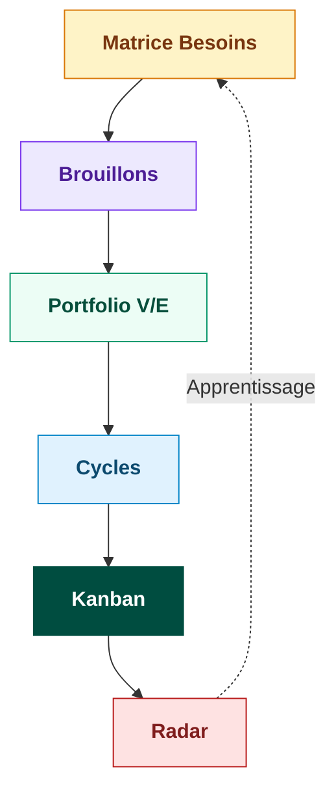

# Application — Projet

> Playbook STTNS v1.5 — export Aide

Comment incarner le framework STTNS sur Projet — surfaces et garde-fous du produit réel.

## Contexte — Projet

Sur **Projet**, STTNS n'est pas un reporting : c'est le système nerveux de décision. Avant d'engager du capital-temps, l'équipe répond à trois questions :

1. Quelle douleur marché ancrons-nous dans la Matrice Besoins ?  
2. Quel Impact (I:0–3) et quel JTBD portent la Feature ?  
3. Quels Jours et Risque la Tech accepte-t-elle ?

*Application Projet — même flux que le produit, du Why au Radar.*

> **Pratiques 0 / 0 bis**
>
> Sur **Projet**, Filtre 0 (douleur) et Filtre 0 bis (conformité) restent des rituels d'équipe — le code enforce ensuite JTBD + Impact.

## North Star & métriques

La page **North Star** (/nsm) porte la boussole partagée de **Projet** : une NSM et ses Input Metrics.

Bonne pratique : chaque Feature devrait pouvoir nommer quelle Input Metric elle déplace. Ce n'est **pas** un hard-stop API — contrairement à Impact 0 et au lien JTBD.

| Question | Réponse attendue |
| --- | --- |
| Quelle NSM ? | Une métrique unique, lisible Produit et Tech. |
| Quelle Input Metric ? | Le levier immédiat que la Feature pousse. |
| Où la suivre ? | Surface `/nsm` du projet — pas un KPI fantôme hors STTNS. |

## Matrice Besoins — Why Spine

Pour **Projet**, le Why vit exclusivement dans **/why** : personas Spine, Pain Points, JTBD.

L'ancien catalogue **`/personas`** est **totalement gelé** et **redirigé en permanence** vers **`/why`**. Ne plus créer ni éditer hors Matrice Besoins.

> **Lien Feature → JTBD**
>
> Codé : aucune Feature finalisable sans job métier lié (`context_type: job`). La Matrice Besoins alimente Brouillons et Portfolio.

> **Legacy /personas**
>
> Gel + redirection permanente vers `/why`. DRAFT / READY n'existent pas sur le flux Spine actif.

- **Personas Spine** — archetypes du projet (segment, description, statuts `todo` · `in_progress` · `review` · `done`).
- **Pain Points** — frictions rattachées au persona.
- **JTBD** — jobs reliés aux Features via `sttns_context_links` (`context_type: job`).

## Discipline Valeur / Effort

Sur **Projet**, triade stricte : Produit = Impact **I:0–3** · Tech = Jours + Risque **R:1–3** · Système = Ratio V/E Epic.

> **Hard block Impact I:0**
>
> Codé : Feature (et Stories) bloquées à l'entrée en `in_progress` tant que l'Impact reste à 0. Revaloriser ou archiver.

| Acteur | Responsabilité | Surface |
| --- | --- | --- |
| **Produit** | Impact I:0–3 + JTBD (`context_type: job`) | Brouillons · Portfolio |
| **Tech** | Jours + Risque R:1–3 | Stories · Cycles · Kanban |
| **Système** | Ratio V/E + hard-stops | Portfolio · Radar · Arbre |

## Exécution, Shape Up & Radar

Une fois le cycle engagé : Stories découpées (plafond 5 jours), Kanban honnête, Radar en fin de cycle.

Si **Shape Up** est activé (`executionUnit: feature` + `epicEqualsCycle`) : le cycle s'aligne sur la Feature ; l'exécution se lit au Kanban Features — sans court-circuiter JTBD ni Impact.

> **Cap sur Projet**
>
> Le chapitre Scoring V/E de l'Aide reste la ground truth de notation. Application n'invente aucune règle locale — elle pointe les surfaces du projet.

- **Cycles** — capacité et objectif.
- **Kanban** — flux `todo` → `in_progress` → `review` → `done`.
- **Radar** — orphelins JTBD, JTBD fantômes, stagnants, Impact 0 → retour `/why`.
- **Arbre / Mind Map** — lecture transverse du même Spine.
