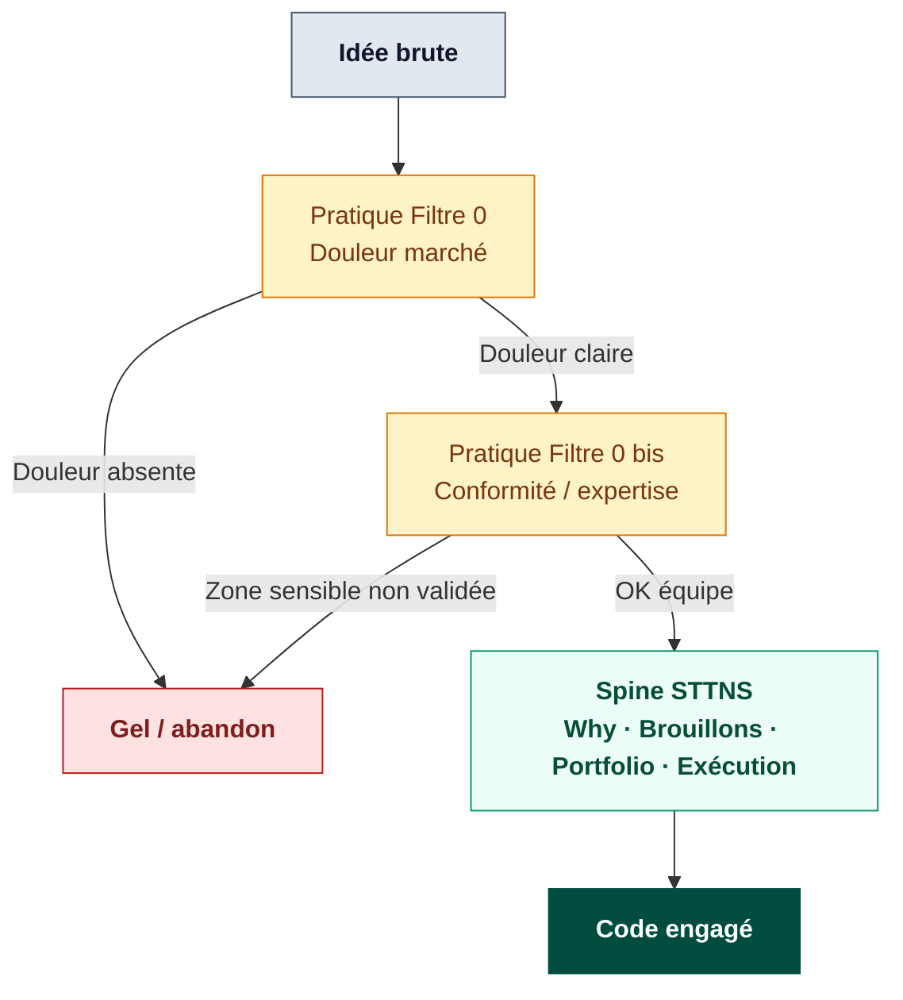
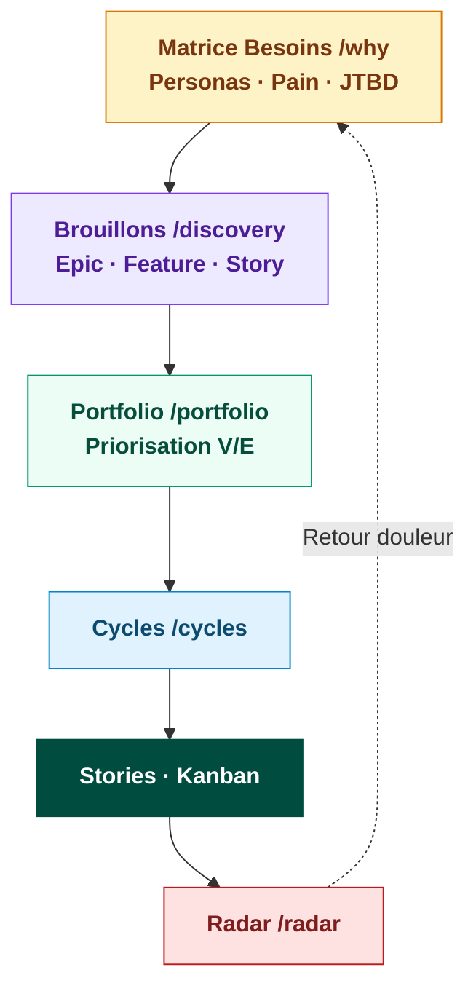

# Framework stratégique

> Playbook STTNS v1.5 — export Aide

Manifeste capital-temps · pratiques d'équipe · garde-fous Spine réellement codés.

## Manifeste — préserver le capital-temps

Le risque mortel d'un produit ambitieux n'est pas de mal coder : c'est d'engager du temps d'ingénierie sur une chose que le marché ne veut pas. Chaque ligne écrite crée de la dette, du coût et une charge de maintenance à vie.

STTNS pose un contrat clair : le **temps** est la ressource la plus rare. Une idée sans douleur ancrée ou sans valeur démontrable doit être **gelée ou abandonnée** — jamais reléguée dans un backlog fantôme.

La ligne directrice reste : $\text{Impact}_{\text{équipe}} \propto \dfrac{\text{Valeur livrée}}{\text{Capital-temps investi}}$. On ne code que pour maximiser ce ratio.

*Esprit du manifeste — pratiques humaines d'abord, puis le Spine qui enforce ce qui est codé.*

> **Règle d'or**
>
> **Pas de douleur, pas de produit. Pas de validation, pas de code.**

## Filtre 0 — No Pain, No Product (pratique)

Porte d'entrée **humaine**, avant toute priorisation V/E : l'initiative résout-elle une douleur réelle du marché, ou une préférence interne ?

Dans le produit, cette pratique se matérialise dans la **Matrice Besoins** (`/why`) : personas Spine, Pain Points, JTBD. STTNS n'empêche pas de créer une Feature sans douleur — l'équipe s'engage à passer ce filtre avant Brouillons / Portfolio.

> **Pratique, pas hard-stop**
>
> Filtre 0 = discipline d'équipe. Le système force ensuite le **lien Feature → JTBD** (`context_type: job`) et le **hard block Impact I:0 → `in_progress`**.

| Question | Critère attendu |
| --- | --- |
| La douleur est-elle claire ? | Elle s'énonce en une phrase, sans jargon interne. |
| Est-elle fréquente ? | Elle revient dans le quotidien du persona. |
| Est-elle coûteuse ? | Temps, argent, confiance ou opportunité — chiffrable. |
| Bloque-t-elle la promesse produit ? | La résoudre augmente la chance d'atteindre la North Star du projet. |

## Filtre 0 bis — Légitimité & conformité (pratique)

Garde-fou pour les zones sensibles : comptabilité, fiscalité, audit, scoring, KYC/AML — tout ce qui engage la responsabilité vis-à-vis d'un tiers régulé.

Le prototypage UX reste autorisé pour apprendre. La **livraison**, elle, dépend d'une validation experte **décidée par l'équipe** — STTNS ne code pas de statut système inventé : les seuls états Spine sont `todo` · `in_progress` · `review` · `done`.

> **Principe de précaution**
>
> Pas d'expertise, pas de logique réglementaire. Pas de validation, pas de release.

| Question | Règle simple | Attitude équipe |
| --- | --- | --- |
| Domaine sensible ? | Compta, audit, scoring, KYC/AML… | Validation experte avant release |
| Règle métier claire ? | Sourcée ou validée | On peut engager un cycle |
| Règle ambigüe ? | Prototype / Spike seulement | Pas de delivery tant que flou |

## Ce que STTNS enforce réellement

Après les pratiques 0 / 0 bis, le produit ne reproduit pas un entonnoir OST / KANO. Il enchaîne des **surfaces Spine** et des **garde-fous codés**.

*Flux produit codé — Matrice Besoins → Brouillons → Portfolio → Cycles → Kanban → Radar.*

| Surface | Rôle dans le code | Garde-fou notable |
| --- | --- | --- |
| **Matrice Besoins** | Personas / Pain Points / JTBD Spine | Socle Why — alimente le lien Feature → JTBD |
| **Brouillons** | Tableau de réunion → Epic · Feature · Story → `todo` | JTBD requis pour finaliser une Feature |
| **Portfolio** | Arbre Epic → Feature, badges V/E | Ratio Epic calculé — zéro saisie valeur/effort |
| **Cycles · Stories · Kanban** | Engagement temporel + exécution | Impact I:0 bloque `in_progress` ; DoD strict sur Story |
| **Radar** | Orphelins JTBD, fantômes, stagnation, Impact 0 | Signaux d'hygiène — pas un workflow inventé |
| **Arbre · Mind Map** | Lecture transverse Spine | Même source de vérité que le reste |

## Priorisation Valeur / Effort (codée)

La priorisation produit repose sur la triade **Produit · Tech · Système** — détaillée dans le chapitre Scoring V/E de l'Aide.

> **Triade uniquement**
>
> Impact · Jours+Risque · Ratio V/E — **aucune** autre méthode de scoring dans le flux actif. Le chapitre Scoring V/E de l'Aide est la ground truth.

- **Produit** — Impact Feature **I:0–3** + lien JTBD (`context_type: job`) obligatoire.
- **Tech** — Jours (0.5–5) + Risque **R:1–3** sur Story (ou Feature en Shape Up).
- **Système** — Ratio Epic $\mathrm{Ratio\ V/E} = \dfrac{\sum \mathrm{Impact}}{\sum \mathrm{Jours}}$ — aucune saisie manuelle.

## Garde-fous système — non négociables

Trois filets sont **matérialisés dans le code** Spine. Ils ne remplacent pas les pratiques 0 / 0 bis — ils empêchent le gaspillage une fois dans le système.

> **Statuts Spine uniquement**
>
> `todo` · `in_progress` · `review` · `done`. Aucun statut inventé sur le flux actif (pas de READY / DRAFT / EXPERT REVIEW système).

> **Catalogue legacy /personas**
>
> `/personas` est **gelé** et **redirigé en permanence** vers `/why` (Matrice Besoins). Ne plus l'utiliser pour créer ou éditer.

> **Décisions d'équipe**
>
> Engager, apprendre (Spike), ou abandonner reste un **jugement humain** — ce ne sont pas des statuts Spine.

- **Hard block Impact I:0** — Feature (et Stories enfants) **ne passent pas en `in_progress`** tant que l'Impact reste à 0.
- **JTBD obligatoire** — Feature non finalisable / non pilotable sans job métier lié (`context_type: job`).
- **DoD strict sur Story** — critères d'acceptation et lien Feature vérifiés avant `done`.
