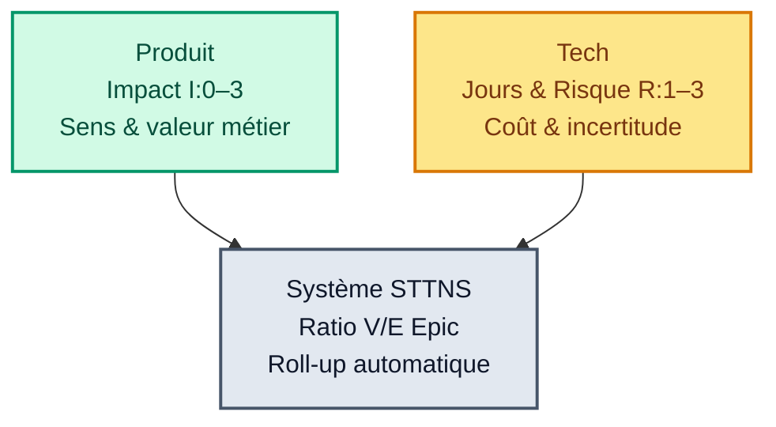
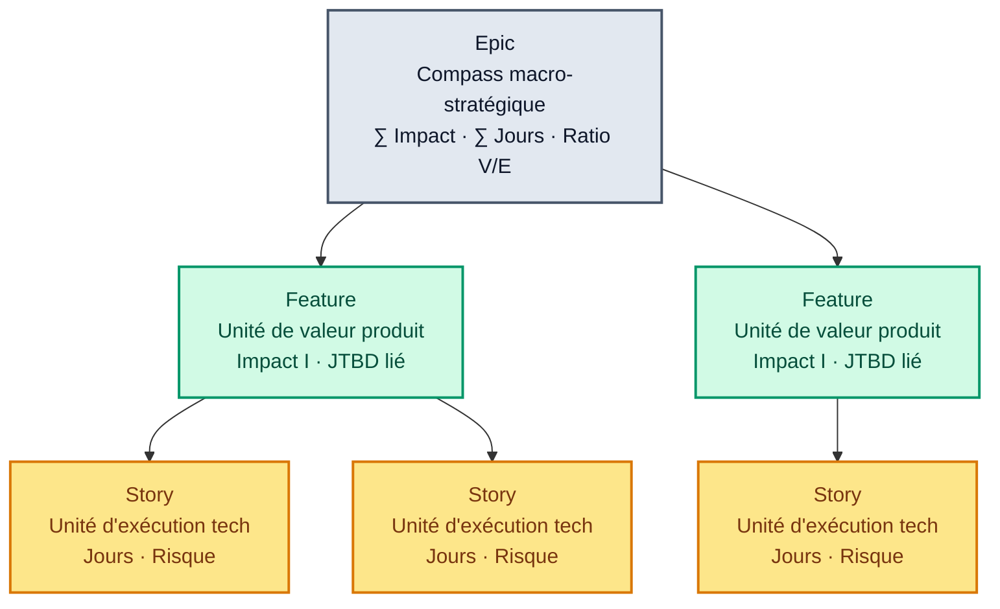
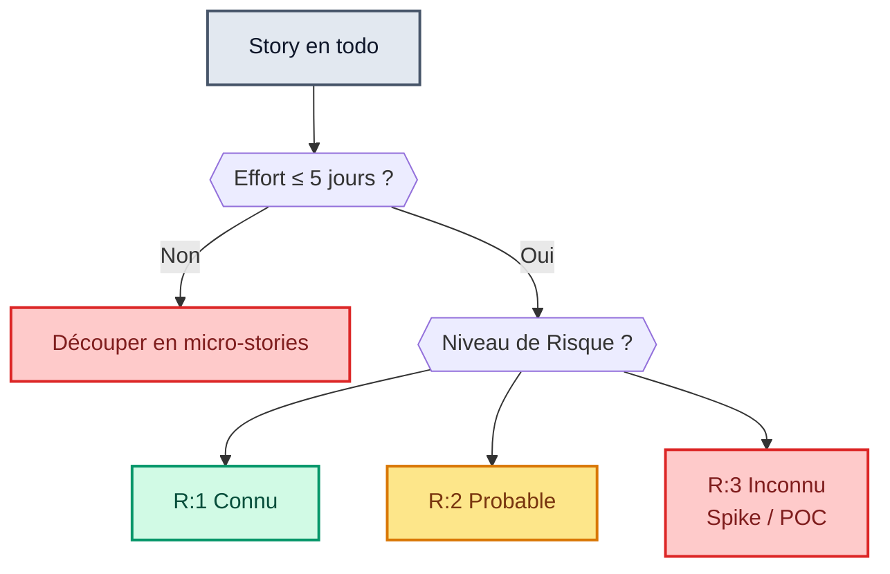
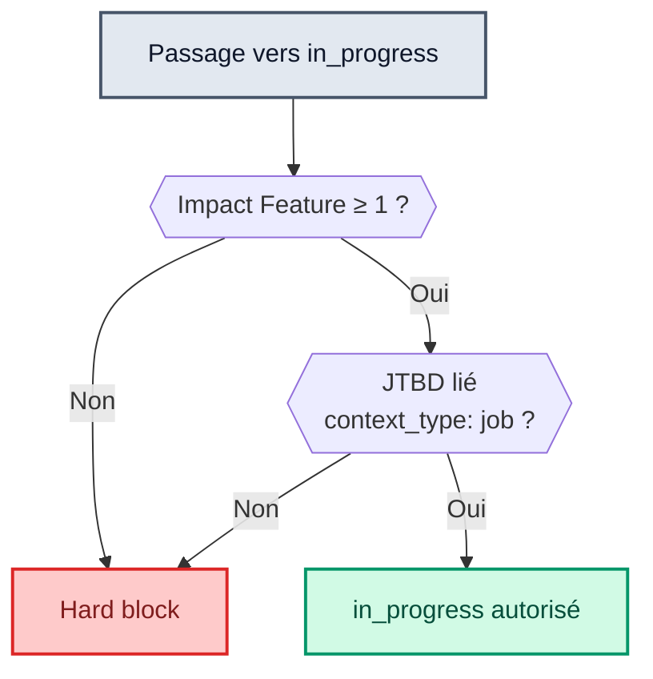

# Scoring Valeur / Effort (v1.5)

> Playbook STTNS v1.5 — export Aide

Triade stricte Produit · Tech · Système — Impact, Jours + Risque, Ratio V/E. Aucune autre méthode de scoring.

## 1. Philosophie — la triade Produit · Tech · Système

STTNS pose une règle simple : personne ne détient toute la vérité, et personne ne peut saisir à la fois la Valeur et le Coût. Trois rôles, trois responsabilités, trois zones de saisie **strictement disjointes**.

**Produit** = Impact **I:0–3**. **Tech** = Jours + Risque **R:1–3**. **Système** = Ratio V/E Epic (roll-up automatique, zéro saisie).

> **Règle d'or**
>
> Deux mains ne saisissent jamais le même score. Le Produit ne fixe pas les jours ; la Tech ne fixe pas l'Impact ; le Système ne fixe rien.

> **Une seule boussole**
>
> La priorisation Spine repose uniquement sur cette triade. Toute autre grille de scoring héritée est **hors doctrine** — ne plus la saisir ni l'utiliser pour arbitrer.

## 2. Les objets Spine — Story · Feature · Epic

Trois strates, une seule constitution. Chaque objet a un rôle défini et un seul saisisseur légitime. Statuts d'exécution : **`todo` · `in_progress` · `review` · `done`** uniquement.

> **Mode Shape Up**
>
> Quand un Epic vaut un cycle et qu'aucune Story n'est encore posée, la Feature porte temporairement Jours + Risque, jusqu'à l'apparition des Stories.

> **Statuts Spine**
>
> Seuls `todo`, `in_progress`, `review`, `done` existent en exécution. Pas de statut système READY / DRAFT sur le flux Spine actif.

| Objet | Rôle produit | Qui saisit quoi |
| --- | --- | --- |
| **Story** | Unité d'exécution technique — lot livrable en quelques jours. | **Tech** : Jours (0.5 à 5) + Risque (R:1 · R:2 · R:3). |
| **Feature** | Unité de valeur produit — bénéfice utilisateur rattaché à un JTBD. | **Produit** : Impact (I:0 à I:3) + lien JTBD (`context_type: job`) obligatoire. |
| **Epic** | Compass stratégique — chantier lisible en un ratio. | **Système** : ∑ Impact, ∑ Jours et Ratio V/E — aucune saisie manuelle. |

## 3. La Valeur — Impact I:0 à I:3 (Produit)

L'Impact vit sur la Feature. C'est le vote produit : combien ce chantier déplace l'aiguille métier. Une seule dimension — pas de reach, pas de confiance moyennée, pas d'effort dilué dedans.

Quatre paliers volontaires. Le zéro existe explicitement pour dire non sans détour.

> **Impact = propriété du Produit**
>
> Même dans le Tableau de brouillons, l'Impact est un vote assumé. Aucun ticket ne migre en cycle sans note Produit.

> **Hard block I:0 → `in_progress`**
>
> Codé : une Feature à **I:0** (et ses Stories) **ne peut pas** passer en `in_progress`. Revaloriser l'Impact, ou archiver.

| Palier | Libellé | Sens produit |
| --- | --- | --- |
| **I:0** | Gaspillage | Aucun impact démontrable — revaloriser, archiver, ou sortir du MVP. |
| **I:1** | Moyen | Confort marginal ou dette contenue — utile mais jamais prioritaire. |
| **I:2** | Fort | Débloque une adoption, une rétention ou une conversion mesurable. |
| **I:3** | Vital | Sans cette Feature, la promesse produit s'effondre. |

## 4. Effort & Risque — Tech (Jours + R:1–3)

L'Effort se pose en jours. Plafond volontaire **5 jours** par Story : tout dépassement signale un mauvais découpage.

Le Risque est l'inconnu opérationnel (R:1 Connu · R:2 Probable · R:3 Inconnu) — pas une « complexité » abstraite.

- **Story > 5 jours** → couper.
- **Effort Feature** = ∑ Jours des Stories dès qu'une Story existe (plus de saisie manuelle).
- **R:3** = drapeau visible, pas un hard block d'exécution.

| Palier | Libellé | Recommandation |
| --- | --- | --- |
| **R:1** | Connu | Techno maîtrisée — exécution linéaire. |
| **R:2** | Probable | Documenté mais jamais livré par l'équipe — cadrer avant. |
| **R:3** | Inconnu | Spike / POC avant engagement calendaire fort. |

## 5. Ratio V/E — Système (Epic)

L'Epic n'accepte aucune saisie de valeur ou d'effort. Le Système agrège Impact des Features et Jours des Stories, puis divise.

Boussole comparative entre Epics — le jugement stratégique reste humain.

> **Formule V/E Epic**
>
> $$\mathrm{Ratio}_{\mathrm{V/E}} = \frac{\sum \mathrm{Impact}_{\mathrm{Features}}}{\sum \mathrm{Jours}_{\mathrm{Stories}}}$$
> 
> Affiche « — » si l'effort agrégé est nul.

| Fourchette | Lecture | Attitude typique |
| --- | --- | --- |
| **≥ 2** | Fort rendement par jour | Engager le cycle en priorité. |
| **1 – 2** | Rendement standard | Séquencer normalement. |
| **< 1** | Coûteux pour l'impact promis | Redécouper, revoir l'Impact, ou justifier stratégiquement. |

## 6. Garde-fous codés

Filets **matérialisés dans le code** — pas des alertes cosmétiques.

> **Hard block Impact I:0**
>
> Feature (et Stories enfants) bloquées à l'entrée en `in_progress` tant que l'Impact reste à **0**.

> **JTBD obligatoire (`context_type: job`)**
>
> Aucune Feature finalisable / pilotable sans lien job métier. Pas de JTBD → pas de finalisation des brouillons / pas d'exécution saine.

> **Catalogue legacy /why**
>
> L'ancien catalogue `/personas` (statuts DRAFT/READY) est **gelé** et **redirigé en permanence** vers `/why` (Matrice Besoins Spine).

## 7. Jugement d'équipe — engager, apprendre, abandonner

Engager un cycle, Spike / apprendre, ou abandonner reste un **jugement humain**. Ces verbes ne sont **pas** des statuts Spine — les seuls états d'exécution restent `todo` · `in_progress` · `review` · `done`.

> **La boussole reste humaine**
>
> Le Ratio V/E objective ; il ne remplace pas le jugement stratégique.

| Attitude | Déclencheur V/E typique | Action |
| --- | --- | --- |
| **Engager** | Impact ≥ 2, risque R:1–R:2 | Cycle / Kanban — passage vers `in_progress` si garde-fous OK. |
| **Apprendre** | Impact incertain ou R:3 dominant | Spike, test terrain — rester en `todo` / Spike dédié. |
| **Abandonner** | Impact 0 ou JTBD introuvable | Archiver — ne jamais forcer `in_progress`. |
